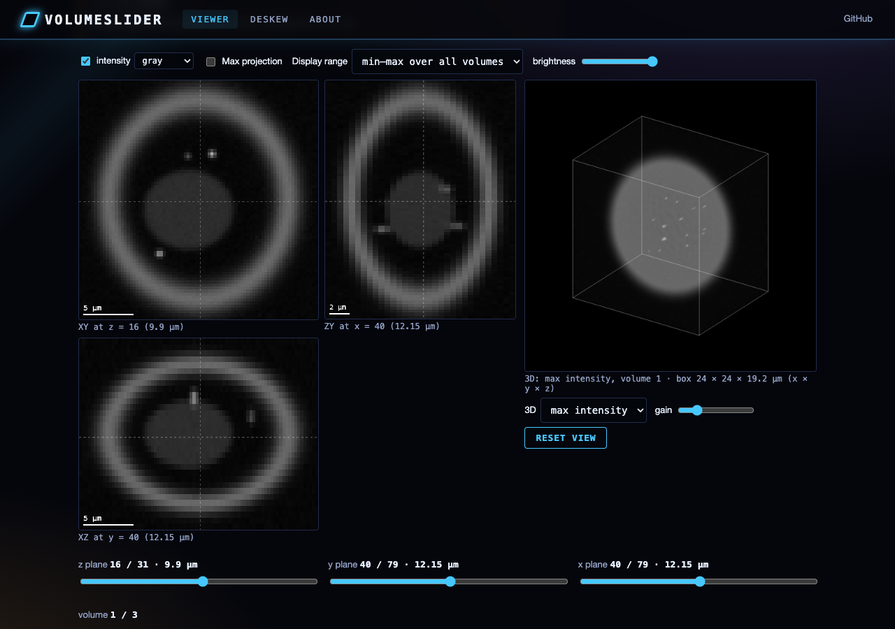
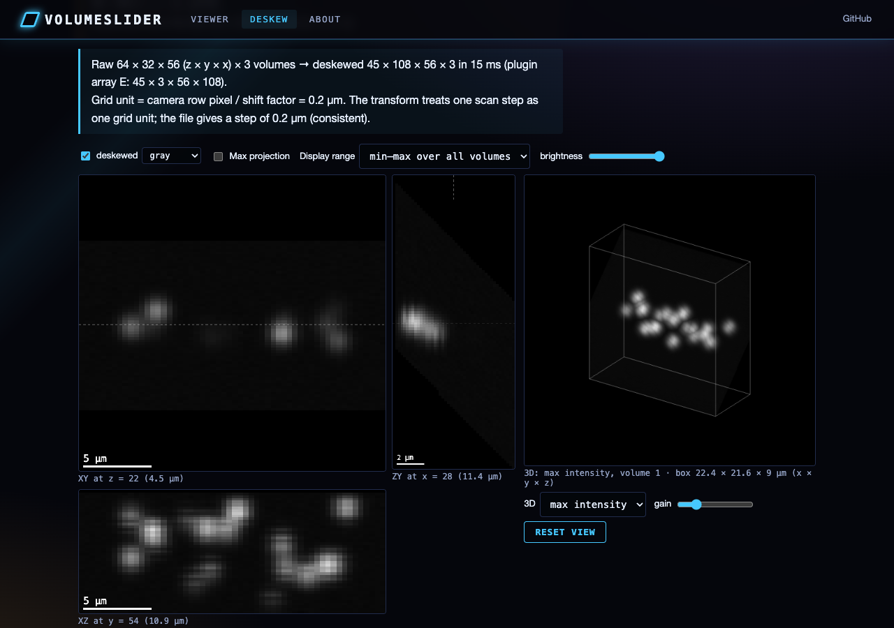
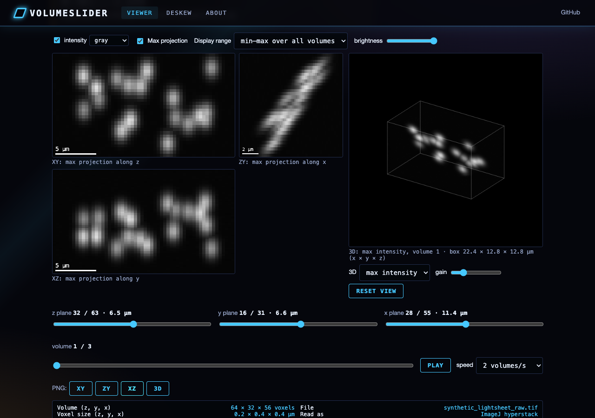

# VolumeSlider Plugin for Flika

## Overview

VolumeSlider is a powerful plugin for [Flika](https://github.com/flika-org/flika), a Python-based image processing suite designed for bioimaging applications. This plugin specializes in the visualization, manipulation, and analysis of multi-dimensional image data, particularly 3D volumes and time series data commonly generated in light sheet microscopy and other volumetric imaging techniques.

## Features

- **Multi-dimensional Data Visualization**: Easily navigate through 3D volumetric data and time series.
- **Orthogonal View Display**: Simultaneously view XY, XZ, and YZ planes of your volumetric data.
- **Data Transformation**: Apply shear transformations to correct for light sheet angular distortions.
- **Overlay Capabilities**: Compare multiple datasets by overlaying them with adjustable opacity and blending modes.
- **ROI Analysis**: Analyze regions of interest with line profile tools and cross-sectional views.
- **DF/F0 Calculation**: Calculate and visualize ratio changes for time series data.
- **3D Visualization**: View your data in 3D using scatter plots and texture plots (textured orthogonal planes).
- **Export Options**: Export data to various formats including Numpy arrays and Imaris (.ims) files.
- **Batch Processing**: Process multiple files with consistent parameters for high-throughput analysis.

## Installation

### Prerequisites
- [Flika](https://github.com/flika-org/flika) (latest version)
- Python 3.6+
- Required packages: numpy, PyQt5/PySide2, pyqtgraph, matplotlib, scikit-image, h5py, OpenGL

### Setup
1. Clone this repository into your Flika plugins directory:
```
git clone https://github.com/gddickinson/VolumeSlider.git ~/.flika/plugins/volumeSlider
```

2. Start Flika and the plugin should appear in the plugins menu.

## Usage

### Getting Started

1. **Launch the Plugin**: From Flika's menu, select `Plugins → VolumeSlider → VolumeSlider`
2. **Load Data**: Choose to work with the current active window or load a numpy array
3. **Set Volume Parameters**: Specify the number of slices per volume
4. **Navigate**: Use the slice slider to browse through the volume
5. **Process**: Apply operations like baseline subtraction, ratio DF/F0, etc.

### 3D Viewer

The 3D viewer provides multiple visualization options:

1. **Orthogonal Views**: View top, side, and front projections of your data
2. **3D Scatter Plot**: View thresholded points in 3D space
3. **Texture Plot**: View volumetric data as textured planes in 3D

### Data Processing

- **Subtract Baseline**: Remove background signal
- **Ratio DF/F0**: Calculate change relative to a baseline period
- **Apply Filters**: Apply Gaussian filters with adjustable parameters
- **Data Transformation**: Correct for light sheet angle distortions

### Export Options

- **Export to Window**: Create a new Flika window from processed data
- **Export to Array**: Save processed data as a numpy array
- **Export to Imaris**: Save in .ims format for visualization in Imaris software

## Advanced Features

### Overlay Controls

The plugin provides extensive control over data overlays:

- **Opacity Control**: Adjust transparency of overlaid datasets
- **Color Map Selection**: Choose from various color maps for better visualization
- **Blending Modes**: Select different blending methods (Source Over, Overlay, Plus, Multiply)

### Batch Processing

Process multiple files with the same parameters:
1. Select "Batch Process" in the main VolumeSlider dialog
2. Set your processing parameters
3. Select an input directory containing your files
4. Start processing

## Web interface

**Live site: https://gddickinson.github.io/VolumeSlider/** (static, everything runs in your browser; nothing is uploaded)

- **Viewer**: open a 3D/4D TIFF (ImageJ hyperstack, OME-TIFF or a plain page stack; uncompressed, LZW, Deflate or
  PackBits; BigTIFF) and browse XY / ZY / XZ slices or max projections, a WebGL2 volume render and the volumes in
  time, all at the voxel size read from the file (or set by hand). "Slices per volume" re-splits a flat stack the way
  the plugin does.
- **Deskew**: the plugin's light-sheet shear transform (theta, shift factor and the axis it stretches, input/display array orders), ported to
  JavaScript; node tests check it against the Python voxel for voxel.
- Two **synthetic** demo volumes (not microscope data), made by `scripts/make_demo.py`: a 4D cell and a raw oblique
  light-sheet scan of beads that the transform deskews.





### Run the web app

```
pip install -r requirements-web.txt
python run_web.py          # http://127.0.0.1:8233
```

The local app adds Python cross-checks: reading your TIFF with tifffile, and running the plugin's shear transform on
the demo to compare with the browser. Tests: `python -m pytest -q tests` (Python + node). The static site is built
with `python scripts/build_static.py` and published by `.github/workflows/pages.yml` on every push to main.

## Plugin Structure

- `volumeSlider_Start.py`: Entry point for the plugin
- `volumeSlider_Main.py`: Core functionality and data handling
- `volumeSlider_Main_GUI.py`: Main interface components
- `volumeSlider_3DViewer.py`: 3D visualization components
- `helperFunctions.py`: Utility functions
- `overlayOptions.py`: Controls for overlay appearance
- `texturePlot.py`: 3D texture visualization
- `exportIMS.py`: Imaris file export functionality
- `tiffLoader.py`: Functions to load TIFF files
- `shear_transform.py`: the light-sheet shear transform (no Qt / flika; re-exported by `helperFunctions.py`)
- `web/`: the web interface (see above)

## Troubleshooting

- **Memory Issues**: For large datasets, ensure your system has sufficient RAM
- **Display Problems**: Update your graphics drivers for optimal 3D visualization
- **File Format Errors**: Ensure your data is properly formatted (tiff, numpy arrays)

## Contributing

Contributions to improve VolumeSlider are welcome. Please feel free to submit pull requests or create issues for bugs and feature requests.

## License

This plugin is released under the [MIT License](LICENSE).

## Acknowledgments

- [Flika Team](https://github.com/flika-org/flika) for creating the core platform
- Contributors to pyqtgraph, numpy, and scikit-image
